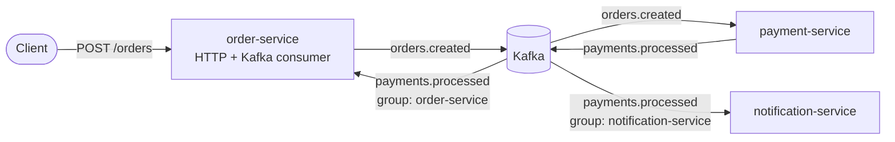

# Kafka Microservices with NestJS


An event-driven order flow made of three **NestJS** microservices that talk only through **Apache Kafka**. It runs locally with Docker Compose and on **Kubernetes**.

## Architecture



1. **order-service** accepts an order over HTTP, stores it as `PENDING_PAYMENT` and publishes `orders.created`.
2. **payment-service** consumes the event, approves or declines the payment, and publishes `payments.processed`.
3. **order-service** consumes the result and moves the order to `CONFIRMED` or `CANCELLED`.
4. **notification-service** consumes the same event in its **own consumer group** and sends the customer a message (logged for now).

## Distributed-systems concepts shown

| Concept | Where |
| --- | --- |
| Shared, versioned event contracts | `src/contracts/` (`version` field on every event) |
| Partition-key ordering | Events keyed by `orderId`, so one order's events stay in order |
| At-least-once delivery → **idempotent consumers** | Payment processor never charges an order twice; order-service ignores late or duplicate results |
| Fan-out with consumer groups | order-service and notification-service both receive every `payments.processed` |
| Horizontal scaling | Consumers in one group split partitions (`replicas: 2` in k8s) |
| Idempotent producer | `idempotent: true`, `maxInFlightRequests: 1` |
| Hybrid NestJS app | order-service serves HTTP **and** consumes Kafka |
| Health probes | `/health` used by Docker and Kubernetes readiness/liveness probes |

## Run locally

```bash
docker compose up --build
```

- Order API: http://localhost:3000
- Kafka UI (topics, messages, consumer lag): http://localhost:8080

```bash
# Approved payment
curl -XPOST localhost:3000/orders -H 'Content-Type: application/json' \
  -d '{"customerId":"cust-42","amount":150000,"currency":"BDT"}'

# Declined (over the 500,000.00 limit)
curl -XPOST localhost:3000/orders -H 'Content-Type: application/json' \
  -d '{"customerId":"cust-42","amount":60000000,"currency":"BDT"}'

curl localhost:3000/orders        # watch status change PENDING_PAYMENT -> CONFIRMED / CANCELLED
docker compose logs -f notification-service
```

Without Docker for the services (Kafka still in Docker):

```bash
docker compose up -d kafka
npm install
npm run start:payment & npm run start:notification & npm run start:order
```

## Deploy to Kubernetes

CI pushes the image to GHCR on every push to `main`. Point `k8s/configmap.yaml` at your Kafka cluster (e.g. [Strimzi](https://strimzi.io/)), then:

```bash
kubectl apply -f k8s/
kubectl port-forward svc/order-service 3000:80
```

## Project structure

```
src/
├── contracts/              # topics, event types, Kafka config, health controller
├── order-service/          # HTTP API + payment-result consumer
├── payment-service/        # orders.created consumer → payments.processed producer
└── notification-service/   # payments.processed consumer
k8s/                        # Deployments, Service, ConfigMap
```

## Testing

```bash
npm test   # order state machine, idempotent payments, notification formatting
```

## Roadmap

- [ ] Persist orders in PostgreSQL with the **transactional outbox** pattern
- [ ] **Dead-letter topic** and retry with backoff for poison messages
- [ ] Schema Registry (Avro / JSON Schema) for contract enforcement
- [ ] Saga with compensation (inventory reservation → release on payment failure)
- [ ] OpenTelemetry tracing across services
- [ ] Helm chart and HPA based on consumer lag (KEDA)

## License

MIT © Md. Monirul Islam
